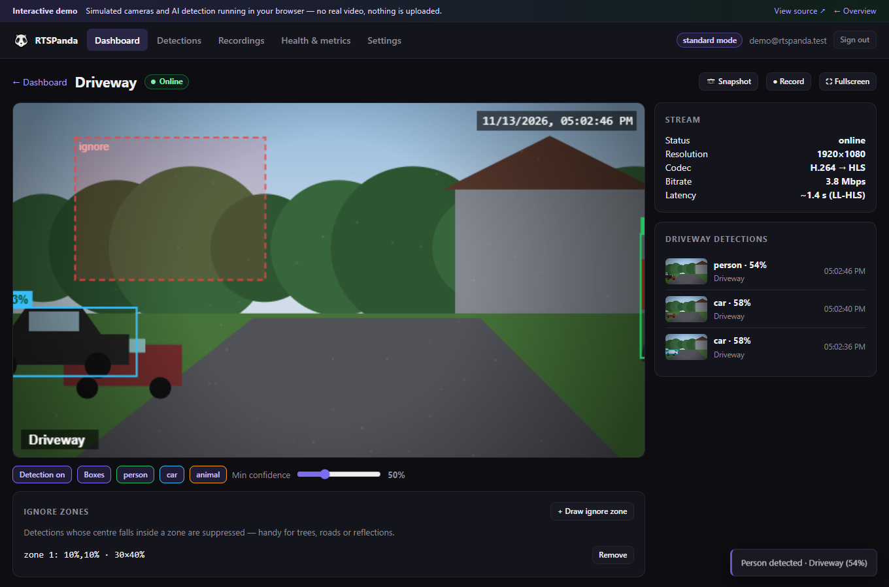

<div align="center">


# RTSPanda

**Self-hosted RTSP camera platform — browser live view, recording, AI detection alerts and Discord notifications.**

[](https://248tech.github.io/RTSPanda/demo/)

[](LICENSE)
[](https://github.com/248Tech/RTSPanda/releases/latest)
[](https://github.com/248Tech/RTSPanda/commits/master)
[](https://github.com/248Tech/RTSPanda/stargazers)
[](https://github.com/248Tech/RTSPanda/issues)


[**Live demo**](https://248tech.github.io/RTSPanda/demo/) · [Project site](https://248tech.github.io/RTSPanda/) · [Deployment modes](#deployment-modes) · [Changelog](CHANGELOG.md)



</div>

> **Try it without installing anything:** open the [live demo](https://248tech.github.io/RTSPanda/demo/) and click **Enter as demo administrator** (or use `demo@rtspanda.test` / `DemoAdmin!2026`). It runs simulated cameras and detection in your browser — no real video, no backend.

RTSPanda is a self-hosted RTSP camera platform for browser live view, recording, and detection workflows. It runs as a single Go backend with an embedded React frontend, a mediamtx relay process, and optional AI services based on deployment mode.

Project tags: `rtsp` `video-surveillance` `golang` `react` `fastapi` `onnxruntime` `raspberry-pi` `docker-compose`

## What This README Covers

This guide is the production operator walkthrough for RTSPanda v0.1.1:

1. Choose the correct deployment mode
2. Prepare the host safely
3. Run one of the supported setup methods
4. Validate health and stream readiness
5. Operate, harden, and upgrade reliably

---

## Deployment Modes

RTSPanda has three runtime modes. Pick one before setup.

| Mode | Target Hardware | AI Path | Local YOLO Detection | Typical Use |
|------|------------------|--------|---------------------|-------------|
| `standard` | x86 server | Local/remote YOLO worker (CPU, ONNX Runtime) | Yes: samples one frame per camera every 30 s by default | Full stack |
| `pi` | Raspberry Pi / ARM | Snapshot AI (Claude/OpenAI) and/or remote YOLO worker | No (local) | Edge ingest/view + alerts |
| `viewer` | Desktop/server | None | No | Live view + optional recording only |

Important: Raspberry Pi is not a local real-time YOLO inference host. Use snapshot AI on Pi or route detection to a remote worker.

---

## Setup Methods At A Glance

All supported setup paths are listed here:

| Method | Command Path | Best For |
|-------|---------------|----------|
| Standard full stack | `docker compose up --build -d` | Single host production |
| Pi mode (viewer/snapshot AI) | `./scripts/pi-up.sh` | Pi edge node |
| Pi + remote AI worker | `AI_WORKER_URL=... ./scripts/pi-up.sh` | Pi ingest + server inference |
| Standalone AI worker | `PI_DEPLOYMENT_MODE=ai-worker ./scripts/pi-up.sh` (server only) | Dedicated inference host |
| **Android no-Docker (2-node)** | `AI_WORKER_URL=... ./scripts/android-up.sh` | **Android/Termux + remote YOLO** |
| **Android no-Docker (3-node)** | Android `viewer` + Pi `pi-up.sh` relay | **Android hub + Pi detection offload** |
| Viewer mode (binary) | `RTSPANDA_MODE=viewer ./rtspanda` | No Docker monitoring |
| Viewer mode (Docker) | `RTSPANDA_MODE=viewer docker compose up --build -d rtspanda` | Lightweight container deployment |
| Source development setup | run backend/frontend/worker directly | Local development and debugging |

---

## Production Walkthrough

### 1. Prerequisites

- Docker Engine 24+ and Docker Compose plugin
- Open ports: `8080` (app), `8888` (HLS served via app reverse path), `9997/9998` internal mediamtx API/metrics
- Stable LAN access to camera RTSP endpoints
- For Standard mode with multiple cameras, CPU headroom (the YOLO worker runs on CPU; there is no GPU execution path yet)
- For Pi mode with Snapshot AI, API key for Claude or OpenAI

### 2. Clone and Baseline Config

```bash
git clone https://github.com/248Tech/RTSPanda.git
cd RTSPanda
```

Configuration is read from environment variables. Docker Compose picks up a `.env` file in the repo root if you create one; see the [Configuration Reference](#configuration-reference) for the variables and their defaults.

### 3. Choose and Execute a Setup Method

Use one of the methods below in full.

### Method A: Standard Full Stack (recommended default)

```bash
docker compose up --build -d
```

What starts:
- `rtspanda` backend/frontend
- `ai-worker` (YOLO detector)

Validation:

```bash
curl -s http://127.0.0.1:8080/api/v1/health
curl -s http://127.0.0.1:8080/api/v1/health/ready
curl -s http://127.0.0.1:8080/api/v1/detections/health
```

### Method B: Pi Mode (viewer + optional snapshot AI)

```bash
chmod +x ./scripts/pi-*.sh
./scripts/pi-preflight.sh
./scripts/pi-up.sh
```

Enable snapshot AI:

```bash
export SNAPSHOT_AI_ENABLED=true
export SNAPSHOT_AI_PROVIDER=claude
export SNAPSHOT_AI_API_KEY=sk-ant-...
export SNAPSHOT_AI_INTERVAL_SECONDS=30
export SNAPSHOT_AI_THRESHOLD=medium
./scripts/pi-up.sh
```

### Method C: Pi + Remote YOLO Worker

On the AI server:

```bash
docker compose -f docker-compose.yml -f docker-compose.standalone.yml --profile ai-worker build ai-worker-standalone
docker compose -f docker-compose.yml -f docker-compose.standalone.yml --profile ai-worker up -d --no-build ai-worker-standalone
curl -s http://127.0.0.1:8090/health
```

On the Pi:

```bash
export AI_WORKER_URL=http://<ai-server-ip>:8090
./scripts/pi-up.sh
```

### Method D: Standalone AI Worker Host (server-class machine)

This is only for dedicated inference nodes. Do not run this on Raspberry Pi.

```bash
export PI_DEPLOYMENT_MODE=ai-worker
./scripts/pi-up.sh
```

### Method E: Android No-Docker (Termux)

See [docs/android-no-docker.md](./docs/android-no-docker.md) for the full walkthrough.

**Quick start (2-node — Android + remote AI server):**

On your AI server (Docker required):
```bash
docker compose -f docker-compose.yml -f docker-compose.standalone.yml \
  --profile ai-worker up -d --no-build ai-worker-standalone
```

On Android in Termux:
```bash
pkg install -y golang ffmpeg wget
git clone https://github.com/248Tech/RTSPanda.git ~/RTSPanda
cd ~/RTSPanda/backend && go build -o ../rtspanda ./cmd/rtspanda
# Download mediamtx ARM64 binary — see docs/android-no-docker.md Step 4
export AI_WORKER_URL=http://<ai-server-ip>:8090
./scripts/android-up.sh
```

Validation:
```bash
curl -s http://127.0.0.1:8080/api/v1/health
curl -s http://127.0.0.1:8080/api/v1/detections/health
# ai_mode should be "remote"
```

### Method F: Viewer Mode (binary, no Docker)

Build or use a compiled binary, then run:

```bash
RTSPANDA_MODE=viewer DATA_DIR=./data ./rtspanda
```

### Method G: Viewer Mode (Docker service only)

```bash
RTSPANDA_MODE=viewer docker compose up --build -d rtspanda
```

### Method H: Source Development Setup

Backend:

```bash
cd backend
go run ./cmd/rtspanda
```

Frontend:

```bash
cd frontend
npm install
npm run dev
```

AI worker:

```bash
cd ai_worker
python -m pip install -r requirements.txt
python -m uvicorn app.main:app --host 0.0.0.0 --port 8090
```

---

## Post-Install Verification Checklist

1. Open `http://<host>:8080`
2. Add one camera with known-good RTSP URL
3. Confirm `/api/v1/cameras/:id/stream` returns:
   - `status=initializing` while startup completes
   - `status=online` and non-empty `hls_url` when playable
4. Verify dashboard card transitions to Live
5. Trigger manual stream reset if needed:

```bash
curl -X POST http://127.0.0.1:8080/api/v1/streams/reset
```

6. Confirm detection health endpoint for your mode:
   - Standard: YOLO worker healthy
   - Pi: snapshot AI configured, or remote worker reachable

---

## Configuration Reference

### Core Runtime

| Variable | Default | Notes |
|---------|---------|------|
| `RTSPANDA_MODE` | auto | `standard`, `pi`, or `viewer` |
| `DATA_DIR` | `./data` | SQLite, snapshots, recordings |
| `PORT` | `8080` | HTTP bind port |

### Streaming / mediamtx

| Variable | Default | Notes |
|---------|---------|------|
| `MEDIAMTX_HLS_ALWAYS_REMUX` | `false` | Keep low latency profile |
| `MEDIAMTX_HLS_SEGMENT_COUNT` | `3` | Playlist segment count |
| `MEDIAMTX_HLS_SEGMENT_DURATION` | `2s` | Segment size |
| `MEDIAMTX_HLS_PART_DURATION` | `200ms` | LL-HLS part duration |
| `MEDIAMTX_SOURCE_ON_DEMAND` | `false` (binary), `true` (docker-compose) | `false`: streams connect proactively. `true`: a camera connects when first viewed and closes after `MEDIAMTX_SOURCE_ON_DEMAND_CLOSE_AFTER` (`10s` in Compose) |

### Detection (Standard mode)

| Variable | Default | Notes |
|---------|---------|------|
| `AI_MODE` | `local` | `local` or `remote` |
| `AI_WORKER_URL` | empty | Remote worker endpoint |
| `DETECTOR_URL` | empty | Direct detector override |

### Thermal monitor (ARM Pi-mode)

| Variable | Default | Notes |
|---------|---------|------|
| `THERMAL_MONITOR_ENABLED` | `false` (except auto-on arm64+pi) | Force thermal monitor on/off |
| `THERMAL_AUTO_RESUME` | `false` | Keep manual recovery behavior after thermal events |

### Snapshot AI (Pi mode)

| Variable | Default | Notes |
|---------|---------|------|
| `SNAPSHOT_AI_ENABLED` | `false` | Enables snapshot analysis loop |
| `SNAPSHOT_AI_PROVIDER` | `claude` | `claude` or `openai` |
| `SNAPSHOT_AI_API_KEY` | empty | Provider API key |
| `SNAPSHOT_AI_INTERVAL_SECONDS` | `30` | Capture interval |
| `SNAPSHOT_AI_PROMPT` | built-in | Scene interpretation prompt |
| `SNAPSHOT_AI_THRESHOLD` | `medium` | Alert sensitivity |

### Security

| Variable | Default | Notes |
|---------|---------|------|
| `AUTH_ENABLED` | `false` | Enable API token auth |
| `AUTH_TOKEN` | empty | Required when auth enabled |

Auth protects the `/api/` routes. The `/hls/` video proxy and `/metrics` are **not** behind the token, so do not expose port 8080 beyond a trusted network or put RTSPanda behind a reverse proxy that enforces its own authentication.

---

## Production Hardening

Recommended for long-running deployments:

1. Put RTSPanda behind a reverse proxy with TLS
2. Restrict app port access to trusted LAN/VPN
3. Enable auth token and rotate it periodically
4. Mount `DATA_DIR` to durable storage
5. Back up SQLite and recording metadata daily
6. Watch container restart patterns and mediamtx logs
7. Keep host clock and timezone correct for event ordering

---

## Operations

### Logs

```bash
docker compose logs -f rtspanda
docker compose logs -f ai-worker
```

Pi profile logs:

```bash
docker compose -f docker-compose.yml -f docker-compose.standalone.yml --profile pi logs -f rtspanda-pi
```

### Upgrade

```bash
git pull
docker compose up --build -d
```

Pi profile upgrade:

```bash
git pull
./scripts/pi-up.sh
```

### Rollback Strategy

1. Keep the previous image/tag available
2. Back up `DATA_DIR` before upgrades
3. If needed, redeploy previous tag and restore data backup

---

## Troubleshooting

### Stream stuck in `initializing`

- Verify camera RTSP URL with VLC or ffplay
- Confirm camera credentials and codec support
- Check backend logs for mediamtx path add errors
- Trigger stream reset endpoint
- Validate camera and host are on routable network

### API healthy but video offline

- Confirm `/api/v1/cameras/:id/stream` `hls_url` is non-empty
- Check whether HLS playlist is reachable from app host
- Review firewall rules between app and camera

### Detection not firing

- Standard mode: check `ai-worker` health and model load
- Pi mode: verify snapshot AI provider/API key
- Remote mode: verify `AI_WORKER_URL` connectivity

---

## Documentation Index

- [Android no-Docker setup](./docs/android-no-docker.md)
- [Raspberry Pi setup](./docs/raspberry-pi.md)
- [Cluster mode (Pi + remote AI + Android 3-node)](./docs/cluster-mode.md)
- [Streaming tuning](./docs/streaming-tuning.md)
- [Testing strategy](./docs/testing-strategy.md)
- [Release notes v0.1.1](./RELEASE_NOTES_v0.1.1.md)

---

## Development Validation

```bash
cd backend && go test ./...
cd frontend && npm run test -- --config vitest.config.ts
cd ai_worker && python -m pytest -q
```

Go tests cover auth, detections, logs and stream management. The API handlers, recordings, notifications and Frigate ingestion do not have automated tests yet, and CI currently deploys the project site only; it does not run these suites.

---

## Status and Limitations

**Status:** beta. Single maintainer; releases v0.0.1 to v0.1.1 shipped March 2026. Issues and pull requests are welcome.

Known limitations:

- **Detection is periodic, not continuous.** The YOLO worker analyzes one ffmpeg-captured frame per camera every 30 s by default (`DETECTION_SAMPLE_INTERVAL_SECONDS`). It runs on CPU only.
- **Frigate support is a webhook receiver.** Frigate posts events to `POST /api/v1/frigate/events`; RTSPanda optionally fetches the event snapshot when `FRIGATE_BASE_URL` is set. There is no MQTT client.
- **No automatic recording retention.** Recording is enabled per camera and saved as 1-hour fMP4 segments you can list, download and delete; old files are not pruned automatically.
- **Single shared auth token**, off by default, and it does not cover `/hls/` or `/metrics` (see [Security](#security)).
- **Optional cloud AI.** Detection in standard mode is local. Discord captions (OpenAI) and Pi snapshot AI (Claude or OpenAI) send frames to those providers only when you configure an API key.
- **Prometheus metrics are minimal:** global counters and an average detection latency, not per-camera series.

---

## License

MIT (`LICENSE`).
